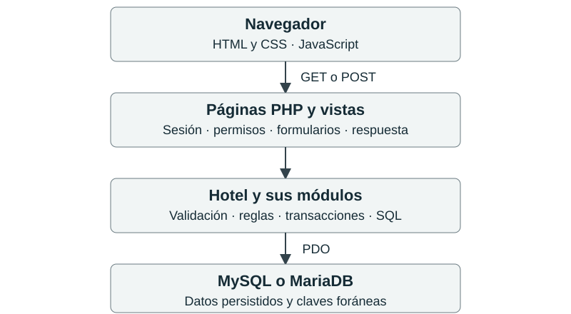
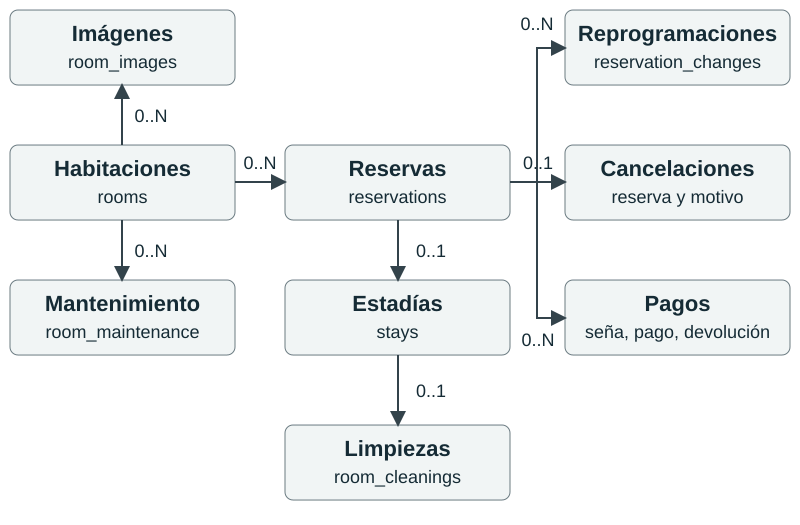
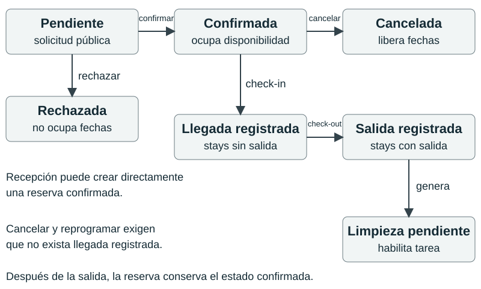

# Hotel Aurora

Instituto Superior de Formación Docente y Técnica N.º 28

Tecnicatura en Desarrollo de Software

Materia: Desarrollo de Sistemas Web

Profesora: Milagros Luzzi

Ciclo lectivo: 2026

Trabajo Práctico Integrador

Aplicación web para la gestión de reservas hoteleras

Estudiante: Dugarte, José

Versión del informe: 23 de octubre de 2026

Entrega prevista según consigna: 16 de noviembre de 2026

<!-- page -->

## 1 Presentación del proyecto

Hotel Aurora es una aplicación web académica para un hotel ficticio. Permite consultar habitaciones y solicitar una estadía, mientras recepción administra reservas, llegadas, salidas, limpieza, mantenimiento y pagos manuales. Integra una interfaz en HTML, CSS y JavaScript con un servidor PHP y persistencia en MySQL o MariaDB.

El propósito es mantener una visión consistente de la disponibilidad y de cada reserva. La versión local incluye los recorridos principales y cuenta con una última ejecución registrada de 616 comprobaciones del sistema y 17 de carga de datos de ejemplo. El informe describe el alcance implementado al 23 de octubre de 2026 y las verificaciones que todavía deben completarse para la entrega.

### Problema y necesidad

En el escenario propuesto, registrar reservas en listas separadas puede generar fechas superpuestas, dudas sobre la presencia real de huéspedes y falta de seguimiento de habitaciones que requieren limpieza o reparación. También dificulta conocer cuánto se recibió por una estadía y cuánto falta cobrar.

La aplicación reúne estos datos y comprueba las condiciones antes de guardar cada operación. El problema se plantea como una situación académica de gestión; no se presenta como un relevamiento realizado a un hotel real.

### Objetivos

- Centralizar solicitudes y reservas, evitando confirmaciones superpuestas para una habitación.
- Distinguir la ocupación prevista de las llegadas y salidas registradas.
- Registrar limpieza y mantenimiento para orientar el trabajo de recepción.
- Conservar cambios, cancelaciones y movimientos de pago con su responsable y fecha.
- Demostrar validación, sesiones, permisos, persistencia y pruebas en una aplicación integrada.

### Actores y alcance

| Actor | Operaciones disponibles |
| --- | --- |
| Visitante | Consultar el catálogo y enviar una solicitud de estadía con datos ficticios. |
| Recepcionista | Consultar el panel y calendario; crear, confirmar, rechazar, cancelar y reprogramar reservas; registrar estadías, limpieza, mantenimiento y pagos. |
| Administrador | Realizar las operaciones de recepción y administrar habitaciones, imágenes y cuentas de recepción. |

El huésped se registra dentro de la reserva y no tiene una cuenta de acceso propia. La aplicación funciona localmente en XAMPP. Una solicitud pública queda pendiente hasta que el personal la confirma; no se envían correos ni se cobran importes automáticamente.

<!-- page -->

## 2 Requerimientos funcionales

Los siguientes requisitos describen comportamiento implementado. La matriz de trazabilidad complementaria relaciona cada identificador con archivos y pruebas concretas.

| ID | Requerimiento |
| --- | --- |
| RF01 | Mostrar las habitaciones activas con nombre, capacidad, tarifa e imágenes disponibles. |
| RF02 | Recibir una solicitud pública, validar sus datos y guardarla en estado pendiente sin duplicar el mismo envío. |
| RF03 | Autenticar al personal y cerrar su sesión, diferenciando recepción y administración. |
| RF04 | Consultar solicitudes mediante filtros y abrir su detalle. |
| RF05 | Confirmar o rechazar una solicitud; al confirmar, comprobar habitación activa, fechas y ausencia de reservas o mantenimiento incompatibles. |
| RF06 | Crear desde recepción una reserva confirmada después de consultar disponibilidad. |
| RF07 | Consultar un panel diario con llegadas, salidas, pendientes, disponibilidad y huéspedes alojados. |
| RF08 | Consultar el calendario mensual y por intervalo, filtrar habitación y abrir reservas o bloqueos. |
| RF09 | Registrar llegada y salida reales, con fecha y empleado, evitando movimientos repetidos o incompatibles. |
| RF10 | Generar limpieza pendiente al registrar una salida y permitir marcarla como terminada. |
| RF11 | Bloquear una habitación por mantenimiento entre fechas y levantar el bloqueo con motivo e historial. |
| RF12 | Cancelar una reserva confirmada sin llegada registrada, liberar fechas y conservar el motivo y responsable. |
| RF13 | Reprogramar fechas o habitación de una reserva sin llegada, revisando disponibilidad, importe e historial. |
| RF14 | Registrar señas, pagos y devoluciones manuales, con importe, medio, fecha y concepto. |
| RF15 | Consultar el saldo de la reserva y anular registros de pago incorrectos con motivo y auditoría. |
| RF16 | Consultar cobros, devoluciones y neto por fecha y medio, con acceso a los movimientos. |
| RF17 | Permitir al administrador crear y editar habitaciones, desactivarlas o reactivarlas y añadir imágenes. |
| RF18 | Permitir al administrador crear cuentas de recepción con contraseñas almacenadas mediante hash. |

Las bajas funcionales conservan información: desactivar una habitación, cancelar una reserva y anular un pago no eliminan sus registros. Las operaciones de gestión se realizan mediante formularios protegidos y la decisión final se valida en el servidor.

<!-- page -->

## 3 Calidad y reglas del sistema

### Requerimientos no funcionales

| ID | Requisito y verificación |
| --- | --- |
| RNF01 | Controlar sesión y rol en el servidor. Las pruebas HTTP comprueban accesos de visitante, recepción y administrador. |
| RNF02 | Validar campos y proteger escrituras con CSRF; usar consultas preparadas y escape HTML. Se prueban entradas inválidas, tokens incorrectos y texto con etiquetas. |
| RNF03 | Mantener consistencia ante operaciones simultáneas mediante transacciones y bloqueos. Se prueban procesos concurrentes sobre disponibilidad y pagos. |
| RNF04 | Evitar duplicados en reenvíos de altas mediante tokens únicos y conservar auditoría de cambios relevantes. Se verifican repeticiones y autoría. |
| RNF05 | Ofrecer formularios etiquetados, mensajes comprensibles, navegación con teclado y diseño adaptable. Hay evidencia previa de navegación móvil; resta la revisión final de los módulos nuevos. |
| RNF06 | Permitir instalación local reproducible con scripts SQL, migraciones y datos ficticios. Se comprueba la repetición de migraciones y de la carga demo. |
| RNF07 | Separar configuración privada de archivos públicos y no mostrar detalles internos ante errores. Apache restringe carpetas y las pruebas comprueban respuestas sin credenciales. |
| RNF08 | Mantener código y documentación organizados por responsabilidad. Los módulos de operaciones, reprogramaciones, mantenimiento y pagos se distinguen dentro del dominio Hotel. |

### Reglas que delimitan la operación

Una reserva ocupa desde la entrada inclusive hasta la salida exclusiva. Por ejemplo, del 23 al 25 ocupa las noches del 23 y 24. Pendientes, rechazadas y canceladas no ocupan disponibilidad. Las solicitudes y reservas nuevas requieren al menos una noche y fechas dentro del próximo año calendario.

La llegada exige una reserva confirmada dentro de sus fechas, habitación activa, ausencia de otro huésped sin salida, limpieza terminada y ausencia de mantenimiento incompatible. La salida conserva su fecha real y genera una limpieza pendiente; no cambia automáticamente las noches contratadas.

La limpieza representa el estado actual y permite conservar reservas futuras. El mantenimiento bloquea noches determinadas. Antes de iniciar mantenimiento hoy también se comprueba que no haya huéspedes todavía alojados, aunque su salida prevista haya vencido.

El saldo se calcula con la tarifa registrada en la reserva. Los importes se comparan en centavos enteros. Los pagos manuales no modifican disponibilidad y una salida puede registrarse aunque quede deuda.

<!-- page -->

## 4 Organización y arquitectura

La aplicación utiliza páginas PHP que reciben peticiones, verifican acceso, llaman a las reglas del hotel y generan HTML. JavaScript mejora validaciones y consultas dinámicas; las reglas de negocio se ejecutan también en el servidor.

| Ubicación | Responsabilidad |
| --- | --- |
| public | Páginas HTTP, estilos, JavaScript y recursos públicos. |
| views | Estructura compartida y fragmentos de presentación. |
| src | Validaciones, conexión PDO y clase Hotel con sus módulos de negocio. |
| database y scripts | Esquema, migraciones, instalación y carga demo. |
| config y storage | Configuración local y archivos de imágenes fuera de la raíz pública. |
| tests y docs | Comprobaciones reproducibles y documentación del proyecto. |

La separación es práctica: las páginas combinan control de peticiones y parte de la presentación, y Hotel contiene reglas y consultas SQL. No se afirma una implementación completa de MVC ni una capa de repositorios independiente.

PHP y PDO permiten seguir de forma directa el recorrido formulario, validación, consulta y respuesta, de acuerdo con el enfoque de la materia. MySQL o MariaDB aporta claves foráneas y transacciones. CSS propio y JavaScript sin un framework de interfaz mantienen visible el funcionamiento del Front End.

En una solicitud válida, POST registra el dato y devuelve una redirección 303 a una página GET. Los tokens de alta agregan protección frente al reenvío del POST original. Las consultas dinámicas del panel y calendario usan respuestas JSON privadas y conservan una consulta HTML alternativa.

<!-- page -->

## 5 Modelo de datos

El esquema define once tablas. La reserva relaciona al huésped con una habitación y conserva la tarifa acordada. Las tablas de historial almacenan hechos separados para evitar sobrescribir cambios y movimientos anteriores.

Las flechas indican los registros asociados a cada padre. Los vínculos con usuarios se detallan en el [diccionario de datos](diccionario-datos.md).

| Entidad | Propósito |
| --- | --- |
| rooms y room_images | Inventario de habitaciones y referencias a sus fotografías. |
| reservations | Datos del huésped, fechas, estado, tarifa y resolución. |
| stays y room_cleanings | Llegada y salida reales; limpieza asociada a la salida. |
| reservation_changes | Valores anteriores y nuevos de cada reprogramación. |
| reservation_cancellations | Motivo y responsable de la cancelación. |
| room_maintenance | Intervalo bloqueado y datos de su levantamiento. |
| reservation_payments | Cobros, devoluciones y anulaciones con auditoría. |
| users y login_attempts | Cuentas del personal y control de intentos fallidos. |

Una reserva admite como máximo una estadía y una cancelación. Una estadía admite como máximo una tarea de limpieza. Reprogramaciones y pagos tienen relación uno a muchos con la reserva. Los códigos de habitación, correos de usuarios y tokens de altas relevantes son únicos.

Los datos repetidos deliberadamente en reprogramaciones son instantáneas históricas de fechas, códigos y tarifas. No hay una tabla independiente de huéspedes ni una clave foránea entre login_attempts y users: también se registran intentos sobre identidades inexistentes.

<!-- page -->

## 6 Estados y decisiones de operación

Los estados de reserva son pendiente, confirmada, rechazada y cancelada. La presencia del huésped se representa en stays, no mediante un estado adicional de reservations. Una reserva puede seguir confirmada después del check-out; esto conserva el contrato y permite consultar o completar sus pagos.

### Disponibilidad y operaciones simultáneas

Confirmar y crear reservas comprueba solapamientos dentro de una transacción. Las operaciones que afectan una habitación toman un bloqueo sobre su fila antes de decidir. Reprogramar bloquea las habitaciones en orden numérico para evitar invertir el orden entre dos operaciones. Si una condición dejó de cumplirse mientras se esperaba, se rechaza la operación sin guardar un cambio parcial.

### Señas y pagos

Seña y pago aumentan los cobros registrados; devolución los reduce. Un cobro no puede superar el pendiente y una devolución no puede superar el neto cobrado. Las anulaciones conservan el registro original y agregan motivo, responsable y hora. Los movimientos financieros toman un bloqueo sobre la reserva antes de volver a calcular el saldo.

Reprogramar a un importe menor conserva el exceso como saldo a favor. Cancelar deja el neto cobrado a favor del huésped y no devuelve dinero automáticamente. El alcance actual no contempla penalidades de cancelación. El resumen diario agrupa por fecha declarada del movimiento y refleja las correcciones vigentes, por lo que no constituye un cierre inmutable de caja.

<!-- page -->

## 7 Pruebas y correcciones

La última ejecución registrada, el 23 de octubre de 2026, pasó 616 comprobaciones de reglas, HTTP y concurrencia, además de 17 de carga demo. Cada ejecución crea su propia base temporal y la elimina al terminar. Las pruebas no insertan sus casos en hotel_aurora. Estas cantidades corresponden a aserciones automatizadas, no a requisitos diferentes.

| Caso | Esperado | Obtenido o corrección |
| --- | --- | --- |
| Campos vacíos, correo o fechas inválidas | Rechazo sin alta | Verificado por la suite. |
| Dos confirmaciones superpuestas | Solo una confirmación | Verificado con procesos concurrentes. |
| Reenvío de formulario de alta | Un registro | Verificado con tokens únicos. |
| Recepción accede a administración | Acceso rechazado | Verificado mediante HTTP. |
| Escritura sin CSRF válido | Rechazo sin cambios | Verificado mediante HTTP. |
| Llegada con limpieza pendiente | No registrar llegada | Verificado; se conserva la reserva. |
| Bloqueo sobre una reserva confirmada | Mostrar conflicto y no guardar | Verificado por reglas y pantalla. |
| Cancelación o reprogramación | Conservar historial y actualizar fechas | Verificado por la suite. |
| Dos cobros de 70 sobre un total de 100 | Aceptar solo uno | Verificado con procesos concurrentes. |
| Anular pago incorrecto | Excluirlo del saldo sin borrar auditoría | Verificado por HTTP y pantalla. |
| Cobros sin fecha en la URL | Consultar el día actual | Se detectó un valor inicial vacío; se corrigió y la suite completa volvió a pasar. |

### Evidencia visual

La comprobación de pagos utilizó una reserva ficticia de $65.000. Se registró una seña de $20.000, se anuló con motivo y se cargó una seña correcta de $25.000. El saldo quedó en $40.000 y el resumen diario mostró $25.000, conservando ambos registros. La comprobación de mantenimiento mostró el bloqueo de la habitación y su acceso desde el calendario.

Las capturas se incluyen en el [anexo de evidencia](evidencia.html), con escenario y alcance. No muestran movimientos bancarios reales. La revisión de escritorio no sustituye la prueba móvil: esta última queda pendiente para los formularios nuevos antes de la entrega final.

<!-- page -->

## 8 Ejecución local y entrega

Para una instalación nueva se requiere XAMPP con PHP 8.2 o superior, MySQL o MariaDB y las extensiones PDO MySQL, mbstring y fileinfo. Las pruebas requieren además cURL y proc_open. El proyecto se ubica en C:\xampp\htdocs\hotel-web y se inician Apache y MySQL.

1. En una instalación nueva, ejecutar `C:\xampp\php\php.exe scripts/setup.php` desde la carpeta del proyecto. El instalador no reemplaza una base existente.
2. Consultar las cuentas generadas en config/access.local.txt de forma privada. La configuración local y ese archivo no se incorporan a la entrega pública.
3. Ejecutar `C:\xampp\php\php.exe scripts/seed-demo.php` sin fecha para cargar ejemplos relativos al día de la primera carga. Repetirlo no restablece ni mueve reservas.
4. Abrir `http://localhost/hotel-web/public/` y recorrer catálogo, acceso del personal, panel y calendario.
5. Para actualizar una instalación existente, respaldarla y ejecutar `scripts/migrate.php` antes de poner en uso el código actualizado. No volver a ejecutar setup para forzar un reinicio.

La entrega debe incluir el código actualizado, esquema, scripts, guías y datos ficticios reproducibles. Git no sincroniza los datos locales ni las imágenes guardadas en storage. Las ampliaciones locales no deben suponerse publicadas por el solo hecho de existir un repositorio remoto. El documento [preparación de entrega](preparacion-entrega.md) reúne los controles restantes.

### Fuentes del informe

- Consigna provista: Trabajo Práctico Integrador DSW, secciones 9 a 12 y cronograma; entrega prevista el 16/11/2026.
- Código local de Hotel Aurora: src, public, views y database/schema.sql, versión funcional del 23/10/2026.
- Suites tests/run.php y tests/seed-demo.php; registro de resultados en docs/pruebas-cierre.md.
- Referencia de portada: Misión y Visión, carpeta 02_ANALISIS del proyecto TSDS_PP3_EMPREGES_DUGARTE_2026. Se conservaron institución, carrera, estudiante y disposición; materia y docente se adaptaron a este informe.

<!-- page -->

## 9 Conservación, límites y conclusión

### Seguridad y conservación

Autenticar verifica quién ingresó; autorizar comprueba si puede realizar la operación. Las contraseñas se guardan con hash y se verifican con password_verify. La sesión se renueva al iniciar sesión y las escrituras exigen CSRF. PDO separa SQL y valores; el escape HTML evita interpretar como código los textos de huéspedes o conceptos.

Se conservan reservas, estadías e historiales en lugar de borrarlos desde los flujos normales. La instalación local utiliza una cuenta de base de datos limitada al esquema del hotel. Estas medidas corresponden al alcance académico y no equivalen a una auditoría de seguridad para un servicio público.

### Limitaciones

No se implementan correos, pasarela de pagos, comprobantes fiscales, consumos adicionales, monedas múltiples ni cierre formal de caja. Tampoco se agregaron alertas automáticas o un portal autenticado del huésped. No se evaluaron carga masiva ni despliegue en producción; queda pendiente completar la comprobación móvil de los módulos recientes.

### Conclusión

Hotel Aurora reúne la consulta pública y la gestión de recepción en un flujo persistido y verificable. El principal resultado es distinguir solicitud, reserva, presencia real, preparación de la habitación y pagos, aplicando reglas específicas a cada operación. Las transacciones y el historial permiten explicar qué cambia y qué se conserva ante conflictos, reenvíos y correcciones.

El proyecto permite demostrar la relación entre interfaz, validación en servidor y base de datos, así como la diferencia entre una prueba funcional y una afirmación general de calidad. El cierre de las funciones seleccionadas permite concentrar la etapa restante en la revisión de la entrega, la evidencia móvil y la preparación de la exposición.

